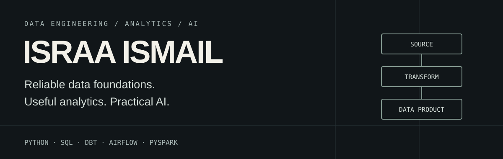

  

  <a href="https://www.linkedin.com/in/israa-ismail-ii">LinkedIn</a> ·
  <a href="https://medium.com/@israa.ismail8i4">Technical Writing</a> ·
  <a href="https://github.com/IIsmail15?tab=repositories">Repositories</a>

# Building reliable data systems from source to insight.

**Data Engineering · Analytics Engineering · Cloud Data Platforms**

I build data systems that turn messy operational data into reliable, tested and usable data products.

My work spans data pipelines, dimensional modelling, orchestration, data quality, cloud infrastructure and analytics.

I’m particularly interested in the engineering foundations that make analytics and AI useful:

**clean data · reliable pipelines · clear models · reproducible infrastructure**

---

## 🧰 Core technologies

  

  
  
  
  
  

  
  
  
  

---

## Featured projects

### 01 / Car Rental Data Platform

**End-to-end Azure data platform from transactional data to a tested analytics warehouse.**

A cloud data engineering project simulating a UK car rental business.

Python generates transactional data in Azure PostgreSQL. Azure Data Factory orchestrates ingestion into ADLS Gen2, Databricks validates and curates the data into Delta tables, and dbt builds a dimensional analytics warehouse in Databricks SQL.

The complete workflow has been successfully orchestrated through ADF and Databricks, with **13 dbt models and 12 data tests passing**.

**Architecture**

`Python/Faker → Azure PostgreSQL → ADF → ADLS Gen2 → Databricks → dbt → Analytics Warehouse`

**Engineering**

`Terraform · PySpark · Delta Lake · Unity Catalog · pytest · dbt tests · GitHub Actions · Docker`

[Explore the platform →](https://github.com/IIsmail15/car-rental-data-platform)

---

### 02 / InsightFlow AI

**Building the data foundation for a future plain-English business analytics tool.**

InsightFlow explores how business users could eventually investigate company data using natural language.

The first milestone focuses on the engineering foundation: PostgreSQL, reproducible synthetic business data, five precisely defined SQL metrics, event-based analytical scenarios and automated validation.

**Current architecture**

`Synthetic business data → PostgreSQL → tested SQL metrics → future natural-language analytics`

**Stack**

`Python · SQL · PostgreSQL · Docker · Data Validation · Testing`

[Explore InsightFlow →](https://github.com/IIsmail15/InsightFlow-AI)

---

### 03 / Hospital Readmission ETL

**Processing 100k+ healthcare encounters with PySpark.**

A Spark-based ETL and analysis workflow using real hospital encounter data.

The project cleans and transforms demographic, diagnosis and medication fields, creates analytical features, uses Spark SQL for summary analysis, and exports curated datasets to Parquet.

**Workflow**

`Raw CSV → PySpark transformations → Spark SQL → Parquet`

**Stack**

`Python · PySpark · Spark SQL · Docker · Parquet · Jupyter`

[Explore the pipeline →](https://github.com/IIsmail15/spark-hospital-readmission-etl)

---

### 04 / LLaMA of Wall Street

**Structured financial NLP on CINECA's Leonardo HPC.**

A team NLP project processing financial discussion at scale on Leonardo HPC.

My contribution focused on ticker extraction using Mistral inference, Pydantic structured outputs, parallel requests and fallback logic. The wider workflow combined extraction with RoBERTa sentiment analysis.

**Architecture**

`Financial discussion → ticker extraction → sentiment analysis → signals`

**Stack**

`Python · Mistral · RoBERTa · vLLM · Pydantic · HPC · SLURM`

[Explore the team project →](https://github.com/IIsmail12/cineca-project)

---

<strong>More work / Crypto ETL with Airflow</strong>

### Crypto ETL with Apache Airflow

A daily Airflow workflow that extracts cryptocurrency market data from the CoinGecko API, transforms it with pandas and loads the latest snapshot into PostgreSQL.

**Workflow**

`CoinGecko API → Airflow → pandas → PostgreSQL`

**Stack**

`Apache Airflow · Python · pandas · SQLAlchemy · PostgreSQL · Docker`

[Explore the pipeline →](https://github.com/IIsmail15/crypto_etl_dag)

---

## Technical toolkit

| Area | Technologies |
|---|---|
| **Languages** | Python, SQL, Bash |
| **Data Engineering** | dbt, PySpark, Apache Spark, Airflow, ETL/ELT, SQLAlchemy, pandas |
| **Databases & Warehousing** | PostgreSQL, Databricks SQL, Snowflake, MongoDB |
| **Azure & Cloud** | Azure Data Factory, ADLS Gen2, Azure Databricks, Azure PostgreSQL, Synapse Analytics |
| **Data Lake & Storage** | Delta Lake, Unity Catalog, Parquet |
| **Infrastructure as Code** | Terraform, AzureRM |
| **Testing & Data Quality** | pytest, dbt tests, validation checks, schema and relationship testing |
| **DevOps & Delivery** | Git, GitHub Actions, Docker, CI/CD, Azure DevOps |
| **Streaming & APIs** | Kafka, REST APIs, FastAPI |
| **Analytics** | Power BI, Jupyter, Streamlit |
| **AI / NLP** | scikit-learn, Mistral, RoBERTa, vLLM, Pydantic |
| **HPC** | CINECA Leonardo, SLURM |

---

## How I approach data engineering

I tend to think about systems in this order:

`Business problem → source data → ingestion → transformation → quality → modelling → delivery`

A pipeline is not finished just because data moved from A to B.

I care about whether it is:

- understandable
- testable
- reproducible
- documented
- useful to the people consuming it

---

## Technical writing

I write about the engineering decisions behind my projects on Medium, including data warehousing, dbt, orchestration and modern data architecture.

[Read my writing →](https://medium.com/@israa.ismail8i4)

---

## Currently exploring

- Reliable cloud data platforms
- Analytics engineering and dimensional modelling
- Data quality and observability
- Infrastructure as Code
- Distributed data processing
- Data foundations for practical AI systems

---

## Let's connect

I’m currently completing an **MSc in Data Science & Business Analytics** and am open to opportunities in **Data Engineering and Analytics Engineering**.

[LinkedIn](https://www.linkedin.com/in/israa-ismail-ii) ·
[Medium](https://medium.com/@israa.ismail8i4)
